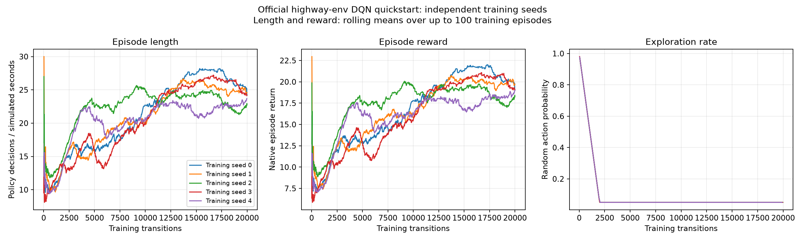

# Official DQN quickstart reproduction

Reference: [highway-env quickstart](https://highway-env.farama.org/quickstart/#training-an-agent).

Each run uses native `highway-fast-v0` traffic, observations, actions and reward, a `[256, 256]` MLP, target-network updates every 50 transitions, and one environment with one gradient update per transition after 200 warmup steps. The training budget is 20,000 transitions per seed. No slower traffic or forced nearby lead is injected.

Training curves include exploration; evaluation uses deterministic actions on held-out traffic seeds starting at 10,000. Random actions use exactly the same initial traffic scenes.

| Training seed | Steps | DQN completion | DQN collision | DQN return | Random completion | Random return |
| --- | ---: | ---: | ---: | ---: | ---: | ---: |
| 0 | 20,000 | 62% | 38% | 19.06 | 8% | 8.25 |
| 1 | 20,000 | 62% | 38% | 20.19 | 8% | 8.25 |
| 2 | 20,000 | 64% | 36% | 19.93 | 8% | 8.25 |
| 3 | 20,000 | 80% | 20% | 21.21 | 8% | 8.25 |
| 4 | 20,000 | 46% | 54% | 16.39 | 8% | 8.25 |

Across 5 training seeds, mean DQN completion is **62.8%** and mean return is **19.36**, versus **8.0%** completion and **8.25** return for random actions.

Each policy has 50 held-out episodes per training seed. These traffic seeds are shared across training seeds; the rows are not all independent traffic samples. Completion means surviving the 30-second episode without crashing. This is performance on the native task, separate from the earlier slower-traffic experiment.

The website shows training curves and one demonstration, not a published held-out collision rate. These measurements reproduce the documented recipe and evaluate it locally; exact trajectories can vary with seeds and package versions.

## Artifacts

- Seed 0: [model](../../models/dqn_quickstart_seed0.zip), [configuration](../../models/dqn_quickstart_seed0.json), [evaluation](../dqn_quickstart_seed0/evaluation.json), [episode rows](../dqn_quickstart_seed0/evaluation_episodes.csv).
- Seed 1: [model](../../models/dqn_quickstart_seed1.zip), [configuration](../../models/dqn_quickstart_seed1.json), [evaluation](../dqn_quickstart_seed1/evaluation.json), [episode rows](../dqn_quickstart_seed1/evaluation_episodes.csv).
- Seed 2: [model](../../models/dqn_quickstart_seed2.zip), [configuration](../../models/dqn_quickstart_seed2.json), [evaluation](../dqn_quickstart_seed2/evaluation.json), [episode rows](../dqn_quickstart_seed2/evaluation_episodes.csv).
- Seed 3: [model](../../models/dqn_quickstart_seed3.zip), [configuration](../../models/dqn_quickstart_seed3.json), [evaluation](../dqn_quickstart_seed3/evaluation.json), [episode rows](../dqn_quickstart_seed3/evaluation_episodes.csv).
- Seed 4: [model](../../models/dqn_quickstart_seed4.zip), [configuration](../../models/dqn_quickstart_seed4.json), [evaluation](../dqn_quickstart_seed4/evaluation.json), [episode rows](../dqn_quickstart_seed4/evaluation_episodes.csv).

## Videos

The seed-0 recordings use the training seed chosen before evaluation and traffic seeds 10,000-10,002. Those episodes were not selected for their outcomes.

- Training seed 0, traffic seed 10000: [video](../quickstart_seed0_videos/episode_01.mp4), TIME LIMIT COMPLETED, 30 simulated seconds.
- Training seed 0, traffic seed 10001: [video](../quickstart_seed0_videos/episode_02.mp4), COLLISION, 19 simulated seconds.
- Training seed 0, traffic seed 10002: [video](../quickstart_seed0_videos/episode_03.mp4), COLLISION, 19 simulated seconds.

Training seed 3 had the highest completion rate in the 50-episode evaluation. Its additional recordings use fresh traffic seeds 20,000-20,002. This model was selected after evaluation, so the five-seed average above remains the primary result.

- Training seed 3, traffic seed 20000: [video](../quickstart_seed3_videos/episode_01.mp4), TIME LIMIT COMPLETED, 30 simulated seconds.
- Training seed 3, traffic seed 20001: [video](../quickstart_seed3_videos/episode_02.mp4), TIME LIMIT COMPLETED, 30 simulated seconds.
- Training seed 3, traffic seed 20002: [video](../quickstart_seed3_videos/episode_03.mp4), COLLISION, 12 simulated seconds.
