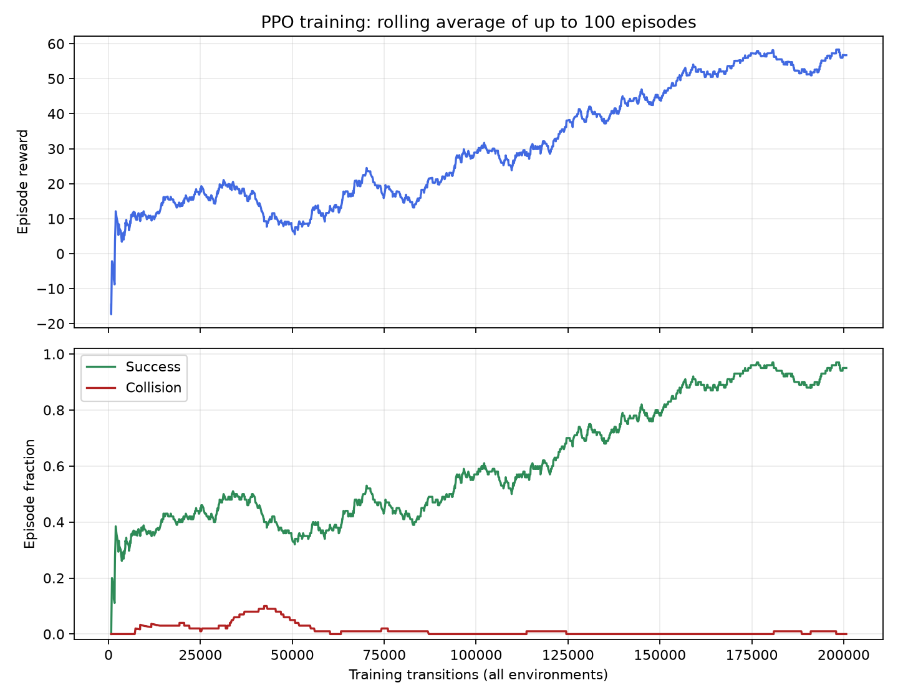

# Measured baseline results

**Historical original-traffic experiment.** These results and recordings predate
the new 12-17 m/s traffic and 35 m lead-car setup. The PPO checkpoint has not been
retrained on slower traffic. Use `baseline_waypoint/test.py --traffic saved` or
`baseline_waypoint/evaluate.py --traffic saved` to select its original task;
default `--traffic slow` evaluates a changed scenario and must be reported separately.

The seed-7 PPO policy was actually trained for **200,704 transitions** (a
200,000-step request rounded up to a full rollout), using four CPU simulation
workers. Learning took **533.8 seconds**, about 8.9 minutes. The initial reward
and observation settings documented in `baseline_waypoint/README.md` were used.

The saved policy was evaluated deterministically on seeds **10,000-10,049**.
Uniform random actions were evaluated on those exact same 50 seeded traffic
scenes and goals. The standalone evaluation command reproduced the training
script's evaluation metrics exactly.

| Metric | Trained PPO | Random actions |
| --- | ---: | ---: |
| Episodes | 50 | 50 |
| Goal successes | 47 | 17 |
| Success rate | 94% | 34% |
| Collisions | 1 (2%) | 1 (2%) |
| Timeouts | 2 (4%) | 32 (64%) |
| Average episode reward | 55.39 | 9.50 |
| Average time to goal, successes only | 6.15 s | 6.91 s |
| Average final distance, all episodes | 12.60 m | 134.64 m |

Success improved by 60 percentage points. Collision rate was unchanged in this
sample; the policy still has a collision and two missed goals. These results
cover one training seed and a sparse three-lane task, not denser or unfamiliar
traffic conditions.

## Does it actually change lanes toward a goal?

| Minimum required lane changes | Episodes | PPO success | Random success |
| --- | ---: | ---: | ---: |
| 0 | 15 | 100% | 26.7% |
| 1 | 25 | 88% | 44% |
| 2 | 10 | 100% | 20% |

The policy succeeds on targets requiring both one and two lane changes. Its
performance is not explained just by holding its initial lane.

## Reward breakdown

Mean weighted component returns, including all failures and timeouts:

| Component | PPO | Random |
| --- | ---: | ---: |
| Goal bonus | +47.000 | +17.000 |
| Collision penalty | -1.000 | -1.000 |
| Distance progress | +12.745 | +0.541 |
| Time penalty | -3.351 | -7.036 |

The four terms sum to each reported mean return. Progress can become negative
after overshooting the target, which explains poor random-policy returns.

## Verification actually performed

- All **10 environment tests passed**, including SB3's environment checker,
  deterministic seeded traffic/goals, observations, reward arithmetic, strict
  radius boundaries, collision priority, timeouts, and physically reaching all
  three goal lanes using native discrete actions.
- The rendering test checked actual goal-colored pixels before and after a
  20 m camera movement. The target moved exactly 100 pixels at 5 px/m while
  its world position stayed fixed. Saved images were visually inspected.
- A 2,048-transition smoke training run saved and reloaded a model, emitted
  TensorBoard/CSV logs and plots, and completed a small evaluation.
- The full PPO run completed, saved a reloadable policy and metrics, and ran
  50 episodes per policy. The standalone evaluation repeated those results.
- All 100 evaluation rows have exactly one outcome, matched initial conditions
  between policies, and reward totals equal to their component sums.
- Three annotated MP4s from the trained model were recorded and decoded; initial,
  intermediate and terminal frames were visually inspected. These use lane-change
  scenarios rather than starting in the goal lane.

## Recorded trained-policy examples

| Seed | Start lane -> goal lane | Outcome | Simulated time | Final distance |
| --- | --- | --- | ---: | ---: |
| 10006 | 1 -> 0 | Goal reached | 5.4 s | 1.82 m |
| 10007 | 0 -> 1 | Goal reached | 6.2 s | 1.24 m |
| 10008 | 1 -> 2 | Goal reached | 6.0 s | 2.15 m |

Videos and PNGs: [visualization folder](../visualization/).
The blue ego, amber traffic, bright green target, true tolerance ring, camera
motion and terminal status are included in each recording. These were tested
offscreen; an interactive window is available through `baseline_waypoint/test.py`.

## Artifacts

- [Model](../../models/ppo_seed7.zip) and [matching configuration](../../models/ppo_seed7.json)
- [Machine-readable evaluation](evaluation.json) and [episode rows](evaluation_episodes.csv)
- [Training episodes](training_episodes.csv), [PPO progress](progress.csv) and [run metadata](run.json)
- [Learning curves](training_curves.png)
- [Setup and code walkthrough](../../README.md)

